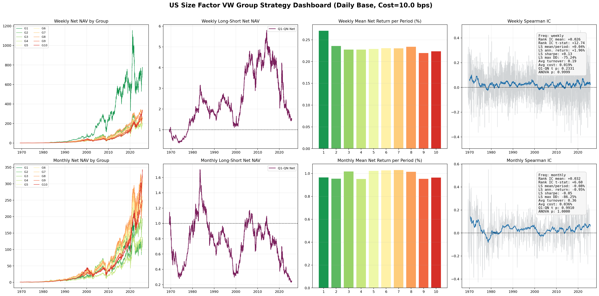

<div align="center">

# US Equity Size Factor

From cross-sectional factor tests to cost-aware calendar-rebalanced portfolios.

  

[Quick start](#quick-start) · [Project map](#project-map) · [Reproduction guide](docs/REPRODUCIBILITY.md)

</div>

---

## Overview

Research the US equity size factor through monthly tests, fixed-hold daily tests, and weekly/monthly calendar-rebalanced portfolios with universe screens and transaction costs.

## Recorded primary result

Strict value-weighted small-minus-big portfolios, with a 180-day listing-age screen, a 90-day fundamentals lag and 10 bps one-way trading costs:

| Frequency | Mean Rank IC | Annualized net spread | Sharpe | Reported t-test p |
|---|---:|---:|---:|---:|
| Weekly | 0.0257 | 1.96% | 0.13 | 0.2331 |
| Monthly | 0.0321 | −0.95% | −0.05 | 0.9910 |

The recorded cross-sectional signal does not translate into a strong, statistically significant net long–short spread under these settings.



## Quick start

Install dependencies and point the runner at your licensed data folder:

```powershell
python -m pip install -r requirements.txt
python us_size_factor_calendar_vw.py --data-dir "C:/data/crsp" --output-dir "./output_calendar_rebalance_strict" --n-groups 10 --cost-bps 10 --min-listing-days 180 --fundamental-lag-days 90
```

Run from the repository root. Expected inputs include `us_daily_stock.zip`, `delisting.zip`, and `CRSP Compustat Merged Database - Fundamentals Quarterly.zip`. The monthly workflow additionally uses `us_month_stock.zip`.

## Project map

| Script | Workflow |
|---|---|
| [us_size_factor_test.py](us_size_factor_test.py) | Monthly cross-sectional size tests |
| [us_size_factor_test_daily.py](us_size_factor_test_daily.py) | Daily fixed-holding-period tests |
| [us_size_factor_calendar_vw.py](us_size_factor_calendar_vw.py) | Calendar-rebalanced value-weighted portfolios |

## Screens and outputs

The strict workflow applies common-stock/exchange screens, seasoning, liquidity and positive-book-equity requirements, and excludes selected security types and financial firms.

Outputs include interval/daily returns, IC, group statistics, tests, holdings and a dashboard. Root-level CSV/PNG files are selected historical artifacts.

## Limitations

The study depends on raw-data vintage, delisting treatment and screen definitions. Separate stock-borrow costs are not modeled. Detailed input schemas, assumptions and output descriptions remain in [the project reference](docs/PROJECT_REFERENCE.md).

## Documentation

- [Reproduction guide](docs/REPRODUCIBILITY.md): inputs, execution order and validation limits.
- [Code and artifact map](docs/REPOSITORY_MAP.md): source and configuration paths.

<sub>Research artifacts reflect the recorded experiment settings. Full results were not regenerated during documentation cleanup.</sub>
